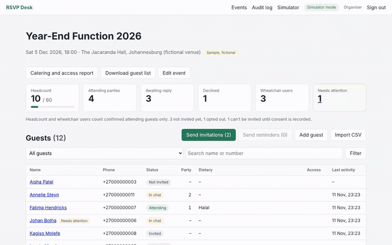
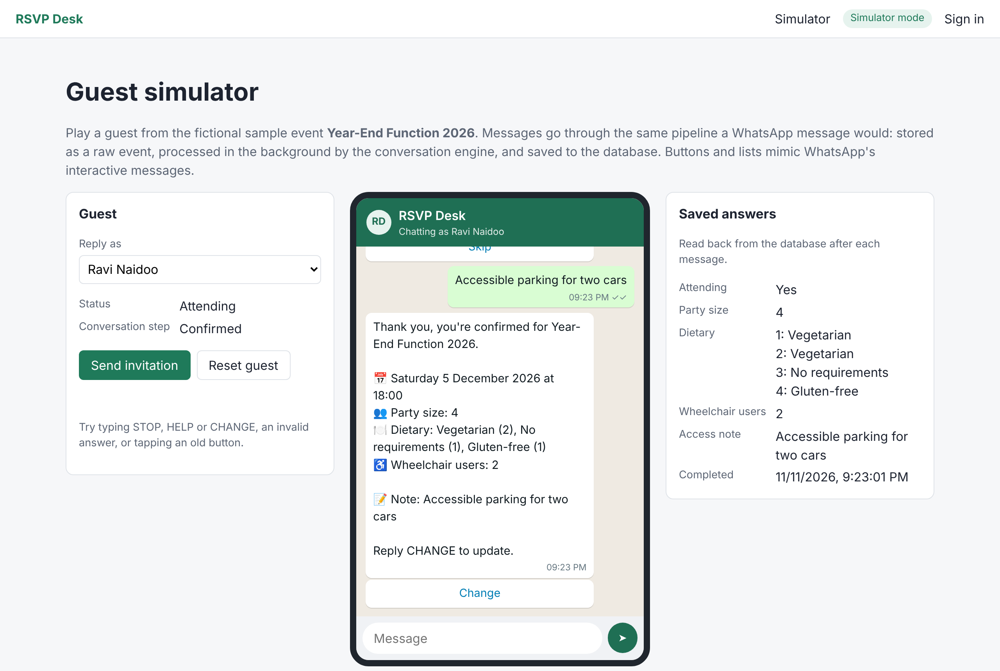
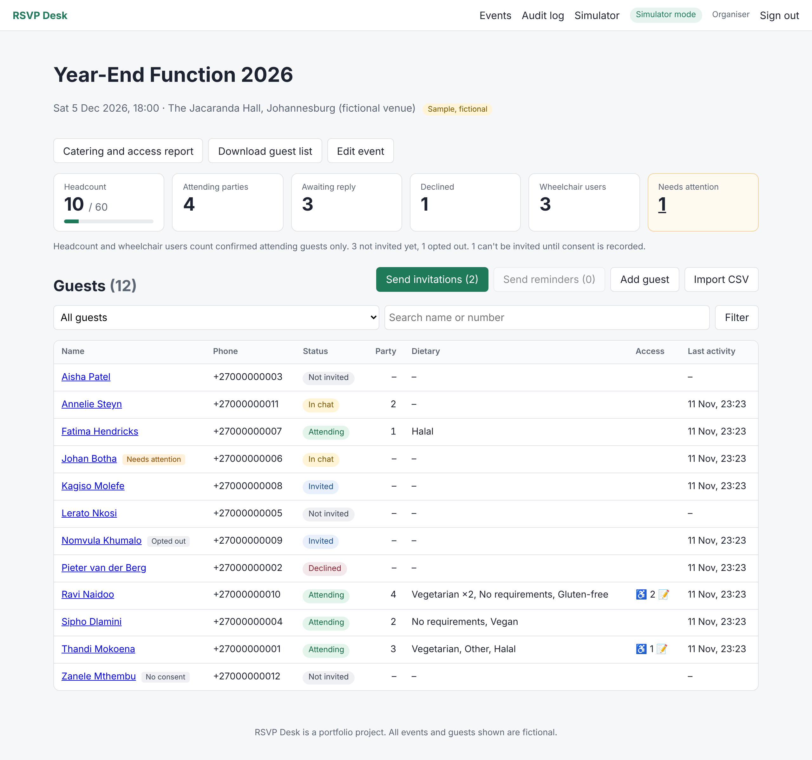
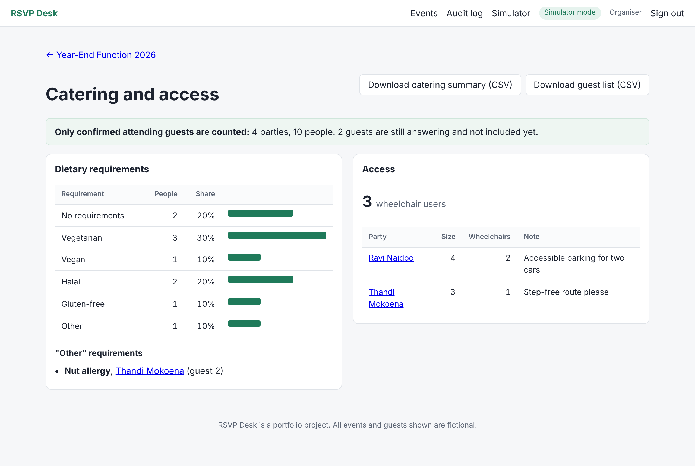
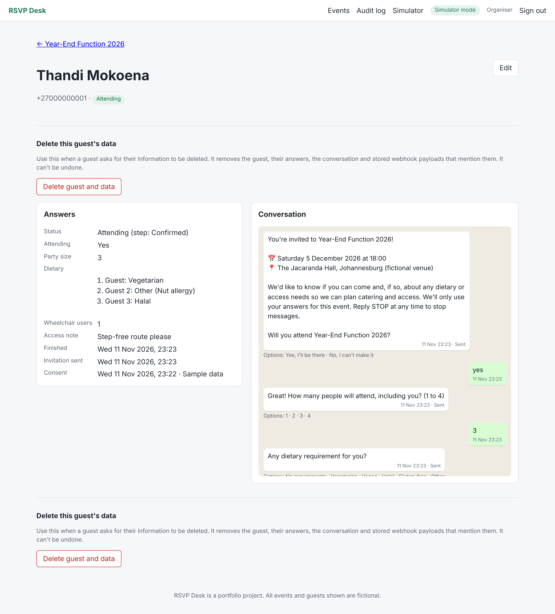

# RSVP Desk

An event management web app where guests receive an invitation and RSVP through a WhatsApp chatbot: attending or not, party size, a dietary requirement per person, wheelchair access and a free-text note. Organisers see live numbers, a catering report and an access report, and can download CSV files.

This is a portfolio project. Every event and guest in the demo is fictional.

> **Honest statement:** simulator mode is the default and needs nothing. Live mode needs your own Meta app, a WhatsApp number and approved message templates; it is built from Meta's current documentation and tested against recorded payload shapes, but sending real messages needs your credentials.



The same recording as video: [docs/demo/rsvp-demo.mp4](docs/demo/rsvp-demo.mp4) (32 s).

## Screenshots

| Guest simulator | Dashboard |
|---|---|
|  |  |
| **Catering and access report** | **Guest detail** |
|  |  | See [Build progress](#build-progress).

## Two modes

| Mode | What happens | Needs |
|---|---|---|
| **Simulator** (default) | Guest messages are typed into a phone-style panel in the browser. | Nothing. |
| **WhatsApp** | Real messages via the Meta WhatsApp Cloud API. | Your own Meta app, a test number and an approved message template. |

Simulator mode is the default so anyone can try the app without a Meta account.

## Architecture

The conversation logic knows nothing about WhatsApp.

```
Guest (WhatsApp)                         Browser (simulator)
      |                                        |
WhatsApp Cloud API  --webhook-->  WhatsAppChannel      SimulatorChannel
                                        \                /
                                      ConversationEngine   (pure, no I/O)
                                                |
                                  Database (guests, RSVPs, messages)
                                                |
                                  Dashboard (staff login)
```

- `src/RsvpDesk.Engine`: the conversation engine. A pure function from (state, inbound message, event details) to (new state, outbound messages, captured answers). It has no package references at all.
- `src/RsvpDesk.Web`: ASP.NET Core (Razor Pages and minimal APIs), EF Core, channels and background workers.

Every inbound message, from the simulator now and from WhatsApp later, takes the same path: stored raw (with a unique id, so repeats are ignored), queued, processed in the background by the engine, then answers, messages and conversation state are saved together and replies are sent through the active channel.

### The conversation

```
Bot:   You're invited to Year-End Function 2026! ... Will you attend?   [Yes, I'll be there] [No, I can't make it]
Guest: yes
Bot:   Great! How many people will attend, including you? (1 to 4)
Guest: 2
Bot:   Any dietary requirement for you?          [No requirements | Vegetarian | Vegan | Halal | Gluten-free | Other]
Guest: Other
Bot:   Please type the requirement, for example nut allergy.
Guest: Nut allergy
Bot:   Any dietary requirement for guest 2?
Guest: halal
Bot:   Does anyone in your party use a wheelchair?   [Yes] [No]
Guest: no
Bot:   Anything else we should know, ...? Tap Skip or type your note.   [Skip]
Guest: Skip
Bot:   Thank you, you're confirmed ... Reply CHANGE to update.
```

STOP, HELP and CHANGE work throughout. All bot text lives in `src/RsvpDesk.Engine/Resources/messages.en.json`.

Design choices are recorded in [docs/decisions.md](docs/decisions.md).

## Run it

With Docker:

```bash
docker compose up --build
# http://localhost:8080/Simulator , health at http://localhost:8080/health
```

The sign-in page shows the demo account. Open **Simulator**, pick a guest, click **Send invitation**, then answer as the guest with the buttons, the list or by typing. The right-hand panel shows what was saved. **Reset guest** starts over.

With the .NET 10 SDK:

```bash
dotnet tool restore
dotnet run --project src/RsvpDesk.Web
```

Tests:

```bash
dotnet test
```

The PostgreSQL migration test runs only when `RSVP_TEST_POSTGRES` holds a connection string. To run the integration tests against PostgreSQL instead of SQLite, also set `RSVP_TEST_DB=Postgres`. CI does both.

### Live WhatsApp mode

Simulator mode needs nothing. Live mode needs your own Meta app, a WhatsApp test number and approved templates. What Meta's documentation says is summarised in [docs/whatsapp-integration.md](docs/whatsapp-integration.md).

1. Create a Meta app with the "Connect with customers through WhatsApp" use case and note the **phone number ID** in API Setup. Create a system user with the `business_management` and `whatsapp_business_messaging` permissions and generate a **permanent access token**.
2. Submit the three templates in [docs/templates.md](docs/templates.md) and wait for approval.
3. Deploy the app on a public HTTPS address and set the secrets as environment variables (or `dotnet user-secrets` locally):
   ```bash
   Channel__Mode=WhatsApp
   WhatsApp__PhoneNumberId=...
   WhatsApp__AccessToken=...
   WhatsApp__AppSecret=...      # App Dashboard > App settings > Basic
   WhatsApp__VerifyToken=...    # any long random string you choose
   ```
4. In the App Dashboard, set the callback URL to `https://<your host>/webhooks/whatsapp`, enter the same verify token, and subscribe to the `messages` field.
5. Add a guest with your own number and consent, send the invitation from the dashboard, and reply on your phone.

### Database

SQLite by default (a file, good for the demo). For PostgreSQL:

```bash
export Database__Provider=Postgres
export ConnectionStrings__Rsvp="Host=localhost;Database=rsvpdesk;Username=...;Password=..."
```

Migrations are applied on startup unless `Database__MigrateOnStartup=false`.

## Build progress

All eight build steps from the spec are done:

1. [x] Skeleton: solution, Dockerfile, CI, health check, migrations
2. [x] Conversation engine with table-driven tests
3. [x] Persistence and simulator mode
4. [x] Dashboard with staff login
5. [x] Catering and access report, CSV exports
6. [x] Invitations, reminders and CSV import
7. [x] Live WhatsApp mode (tested against a fake Graph API; needs your Meta app for a real run)
8. [x] Hardening: audit log, retention job, deletion on request, security headers, screenshots and demo

## Privacy (POPIA)

Dietary and access needs can be special personal information (health, religion), so:

- Guests are messaged only with recorded consent (`ConsentAt`, `ConsentSource`), and the invitation says why the information is collected.
- STOP takes effect at once and blocks invitations and reminders; only an organiser can re-enable.
- Dietary and access answers, the conversation and exports are for **Organisers** only; **Viewers** see numbers without them. Viewing guest details or reports and every export is written to the audit log.
- A guest's data can be deleted on request from their page. A retention job anonymises each event's guests a configurable number of days after the event (keeping only whether a party came and its size) and deletes raw webhook payloads after 30 days. The fictional sample event is exempt.
- Secrets come from user-secrets or environment variables, never the repository. Logs use guest ids, never phone numbers or message text.

## What I'd do next

- **More languages.** All bot text is in one resource file; add `messages.zu.json`, `messages.af.json`, etc., plus a language per guest and translated templates.
- **Check-in at the door:** a QR code per confirmed party and a staff check-in screen with live arrivals against the headcount.
- **Seating plans** using party sizes and access needs (wheelchair spaces near step-free routes).
- **Bigger sends as background jobs** with progress, and automatic re-sending of failed messages once a provider error clears.
- **User management in the app** instead of the command line, with sign-in by email link.
- **Multiple organisations** with data separated per organisation.
